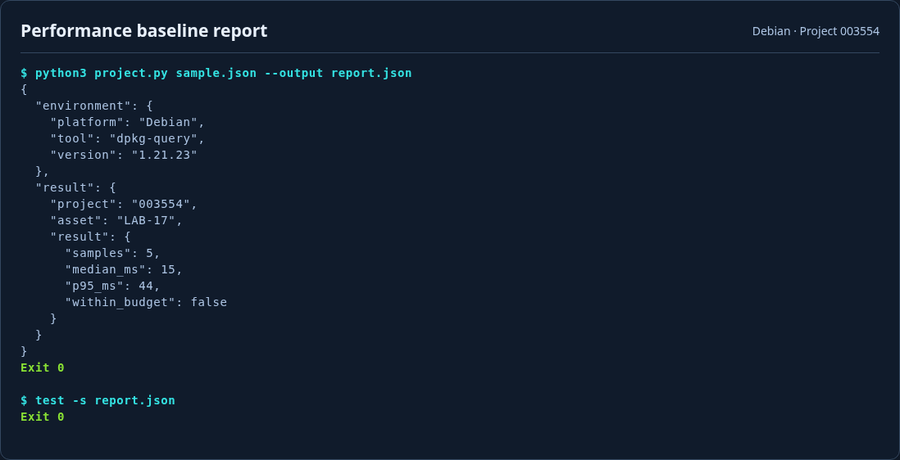

# Debian: Performance Baseline — Reporting for School Lab (Project 003554)

## Project overview

Shared classroom equipment provides the setting for this performance baseline exercise. The embedded code is an AI-generated reference implementation based on the student guide and uses fictional data.

## Problem statement

The school lab needs a reproducible performance baseline workflow focused on reporting on Debian.

## Project objectives

- Calculate median and nearest-rank p95 latency against a stated budget.
- Export an auditable JSON report without overwriting an existing one.
- Reproduce the sample result and inspect how the project handles its documented edge case.

## Technologies used

Debian, dpkg-query, JSON, and Python standard-library modules.

## System architecture

`OS identity → local JSON → validated workflow → terminal or report`

## Features

- Calculate median and nearest-rank p95 latency against a stated budget.
- Export an auditable JSON report without overwriting an existing one.

## Prerequisites

Use Debian in a practice environment with Python 3.11 or later and dpkg-query. Use a text editor and a local practice directory.

## Complete Debian source code

```python
"""Local Debian reference implementation for project 003554."""


from pathlib import Path
import argparse
import json
import platform
import statistics
import subprocess
import sys


EXPECTED_SYSTEM = 'Debian'
PROJECT_ID = "003554"


def label(record, key):
    value = record.get(key)
    if not isinstance(value, str) or not value.strip():
        raise ValueError(f"{key} must be non-empty text")
    return value.strip()


def integer(record, key, minimum=0, maximum=1_000_000_000):
    value = record.get(key)
    if type(value) is not int or not minimum <= value <= maximum:
        raise ValueError(f"{key} must be an integer from {minimum} to {maximum}")
    return value


def array(record, key, allow_empty=False):
    value = record.get(key)
    if not isinstance(value, list) or (not value and not allow_empty):
        raise ValueError(f"{key} must be a list" + ("" if allow_empty else " with at least one item"))
    return value


def series(record, key, maximum=1_000_000_000):
    return [integer({key: item}, key, maximum=maximum) for item in array(record, key)]


def evaluate(record):
    """Calculate median and nearest-rank p95 latency against a stated budget."""
    readings = sorted(series(record, "latencies_ms"))
    rank = (95 * len(readings) + 99) // 100
    p95 = readings[rank - 1]
    budget = integer(record, "budget_ms", minimum=1)
    return {"samples": len(readings), "median_ms": statistics.median(readings),
            "p95_ms": p95, "within_budget": p95 <= budget}


def platform_details():
    if platform.system() != "Linux":
        raise ValueError("This demo requires Debian")
    distribution = platform.freedesktop_os_release()
    if distribution.get("ID") != 'debian':
        raise ValueError("Expected Debian /etc/os-release information")
    version = subprocess.run(['dpkg-query', '--show', '--showformat=${Version}', 'dpkg'], text=True, capture_output=True,
                             timeout=5, check=True).stdout.strip()
    if not version:
        raise ValueError("The platform version command returned no output")
    return {"platform": EXPECTED_SYSTEM, "tool": 'dpkg-query', "version": version}


def load(path):
    value = json.loads(path.read_text(encoding="utf-8"))
    if not isinstance(value, dict):
        raise ValueError("Expected a JSON object")
    json.dumps(value, allow_nan=False)
    return value


def process(args):
    record = load(args.input)
    return {"project": PROJECT_ID, "asset": label(record, "asset"), "result": evaluate(record)}, 0


def main():
    parser = argparse.ArgumentParser(description='Calculate median and nearest-rank p95 latency against a stated budget.')
    parser.add_argument("input", type=Path)
    parser.add_argument("--output", type=Path, help="new JSON report path")
    args = parser.parse_args()
    try:
        environment = platform_details()
        outcome, status = process(args)
        report = {"environment": environment, "result": outcome}
        serialized = json.dumps(report, indent=2, ensure_ascii=False, allow_nan=False)
        if args.output is not None:
            with args.output.open("x", encoding="utf-8") as handle:
                handle.write(serialized + "\n")

        print(serialized)
        return status
    except (OSError, ValueError, OverflowError, RecursionError, subprocess.SubprocessError) as exc:
        print(f"Demo error: {exc}", file=sys.stderr)
        return 2


if __name__ == "__main__":
    raise SystemExit(main())
```

## Implementation explanation

The program verifies the OS and reads dpkg-query to identify the practice environment. The performance baseline calculation works on synthetic input. Export an auditable JSON report without overwriting an existing one.

## Sample input data

Save this synthetic record as `sample.json`.

```json
{
  "asset": "LAB-17",
  "latencies_ms": [
    12,
    15,
    14,
    44,
    17
  ],
  "budget_ms": 30
}
```

## Execution instructions

Copy the Python source to `project.py` and the sample JSON to `sample.json` in the same directory. Choose an unused path for the report.

```sh
python3 project.py sample.json --output report.json
```

## Example output

Illustrative excerpt for the synthetic sample.

```json
{
  "p95_ms": 44
}
```

## Testing and validation

Actual tests ran on a Debian 12 container. The platform command returned the observed version and the sample result repeated. The saved JSON matched the terminal output, and an overwrite attempt was rejected.

```json
{
  "p95_ms": 44,
  "environment": {
    "platform": "Debian",
    "tool": "dpkg-query",
    "version": "1.21.23"
  }
}
```

Captured terminal run on Debian 12 container using the synthetic fixture shown above.



## Error handling

The CLI reports invalid input, missing files, and failed platform checks. Batch and recovery modes include row or fallback details.

## Troubleshooting

- Confirm the documented runtime and copy the complete source block.
- Start with the documented sample and use the filename or request path shown above.
- Compare the observed value with the example before changing an input.

## Limitations

This exercise works on local synthetic records. The only operating-system commands are read-only version checks.

## Learning outcomes

Practice performance baseline using Debian and check a repeatable reporting workflow in the school lab scenario.

## Conclusion

The project records an observable performance baseline result for training case `LAB-17`.

[Back to the Debian project index](../README.md)
